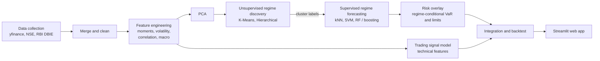

# Regime-Aware Adaptive Trading & Risk Management System

> Detects hidden market regimes in Indian equity data, forecasts the prevailing regime, and tests whether regime-aware position sizing and risk limits beat a regime-blind baseline.

**Course:** DS605 Fundamentals of Machine Learning, M.Sc. Data Science (Autumn 2026)
**Domain:** Finance, Quantitative Risk Management & Algorithmic Trading
**Status:** In development. Course project deadline: **15 Nov 2026**

---

## Table of Contents

1. [Overview](#1-overview)
2. [Problem Statement](#2-problem-statement)
3. [What Makes This Project Different](#3-what-makes-this-project-different)
4. [Objectives](#4-objectives)
5. [System Architecture](#5-system-architecture)
6. [Data Sources](#6-data-sources)
7. [Methodology](#7-methodology)
8. [Theoretical Concepts](#8-theoretical-concepts)
9. [Evaluation and Metrics](#9-evaluation-and-metrics)
10. [Deployment Plan](#10-deployment-plan)
11. [Tech Stack](#11-tech-stack)
12. [Repository Structure](#12-repository-structure)
13. [Getting Started](#13-getting-started)
14. [Work Breakdown](#14-work-breakdown)
15. [Timeline](#15-timeline)
16. [Team](#16-team)
17. [Expected Outcomes](#17-expected-outcomes)
18. [Concepts to Learn (by Owner)](#18-concepts-to-learn-by-owner)
19. [Limitations and Disclaimer](#19-limitations-and-disclaimer)

---

## 1. Overview

Trading and risk systems often apply a fixed strategy and a fixed risk tolerance regardless of prevailing market conditions. This is a widely recognized concern in quantitative risk management: strategies and risk limits calibrated during calm periods can perform poorly when volatility regimes shift sharply, as seen during past stress episodes such as 2008 and March 2020.

This project explores whether such regime shifts can be **detected directly from market data**, and whether that detection can be used to **adjust trading behavior and risk exposure** accordingly.

It is framed as a **market-state detection and adaptive-response problem**, not direct price prediction, since forecasting returns directly is both harder and less reliable with the classical ML techniques available in this course.

## 2. Problem Statement

Design and deploy a system that:

- **(a)** identifies latent market regimes (for example Calm/Trending, Choppy/Uncertain, High-Volatility/Panic, Recovery) from historical Indian equity market data using **unsupervised learning**,
- **(b)** predicts the prevailing regime using **supervised classification**, and
- **(c)** evaluates whether **regime-aware position sizing and risk limits** produce better risk-adjusted performance than a **regime-blind baseline strategy**, on backtested historical data.

## 3. What Makes This Project Different

The individual techniques used here (clustering, classification, VaR estimation) are standard and well established. This project does **not** claim to introduce a new ML method. Within the scope of a course project, it differentiates itself through:

- **A self-assembled, multi-source dataset:** equity indices, a volatility index, cross-sector correlation, commodities, and manually scraped macroeconomic indicators from RBI's public database, rather than a single ready-made dataset.
- **An end-to-end pipeline that reaches a measured outcome:** regime detection feeds a supervised forecasting step, which feeds a concrete downstream decision (position sizing and risk limits). The backtested performance difference is reported explicitly instead of stopping at a model accuracy metric.
- **Two complementary, individually explainable sub-systems:** a risk-overlay component and a trading-signal component, reflecting how quant-analyst and quant-trading roles differ in practice.
- **A working deployment,** rather than a notebook-only submission.

## 4. Objectives

1. Build a multi-asset, multi-source financial feature panel (returns, statistical moments, volatility, correlation, macro indicators).
2. Discover market regimes using unsupervised learning (K-Means, Hierarchical Clustering), validated via silhouette analysis.
3. Train supervised classifiers (kNN baseline, SVM, ensemble methods) to predict the prevailing regime from current features.
4. Build a rule-based risk overlay that adjusts position size and Value-at-Risk thresholds based on the predicted regime.
5. Build a classical ML trading signal using engineered technical features.
6. Backtest regime-aware vs regime-blind strategy performance and report the difference.
7. Deploy the resulting pipeline as an interactive web application.

## 5. System Architecture



The project is split into two sub-systems that meet at the backtest:

| Sub-system | Purpose | Owner |
|---|---|---|
| **Risk overlay** (quant analyst track) | Rolling VaR per regime, regime-conditional position sizing and risk limits | Pujita |
| **Trading signal** (quant trading track) | Technical feature engineering, buy/hold/sell model, backtesting | [Partner's name] |
| **Regime detection core** | Clustering, PCA, classification, integration, deployment | Shared |

## 6. Data Sources

| Source | Data | Role |
|---|---|---|
| `yfinance` (Yahoo Finance API) | Nifty 50, Bank Nifty, sector indices, India VIX, Gold, Crude Oil | Core price, volatility and correlation panel |
| NSE India (nseindia.com) | Official historical index data | Cross-verification of the primary source |
| RBI Database on Indian Economy (DBIE) | Interest rates, inflation (CPI) | Macro enrichment layer (scraped) |

All sources are public. The RBI layer requires manual scraping or extraction rather than an API pull, and it is the main source of dataset enrichment beyond the core price data.

## 7. Methodology

### Phase 1: Unsupervised Regime Discovery

Feature engineering (rolling mean, standard deviation, skewness, kurtosis, correlation), then PCA for dimensionality reduction, then K-Means and Hierarchical clustering. The best model is chosen by silhouette score and validated by checking whether detected regimes align with known historical events.

### Phase 2: Supervised Regime Forecasting

Uses the clustering output as training labels. Trains kNN (baseline), SVM, and an ensemble method (Random Forest / boosting) to predict the regime from current-day features. Evaluated with accuracy, F1-score, and a confusion matrix.

### Phase 3: Risk Overlay (individual contribution, quant analyst track)

Estimates rolling Value-at-Risk (historical simulation method) per regime, then defines regime-conditional position-sizing and risk-limit rules.

### Phase 4: Trading Signal (individual contribution, quant trading track)

Engineers technical and statistical features, then trains a classical ML model to generate buy/hold/sell signals.

### Phase 5: Integration and Backtesting

Combines the signal and the risk overlay, backtests against a regime-blind baseline, and reports Sharpe ratio, maximum drawdown, and cumulative return.

### Phase 6: Deployment

Packages the pipeline (data refresh, regime detection, signal generation, risk-adjusted recommendation) into a deployed web application.

## 8. Theoretical Concepts

- Statistical moments (mean, variance, skewness, kurtosis) as regime-descriptive features
- PCA: variance-maximizing projection via eigen-decomposition of the covariance matrix
- K-Means: minimization of within-cluster sum of squares (Lloyd's algorithm)
- Hierarchical clustering: agglomerative linkage (for example Ward's method) and dendrogram interpretation
- Silhouette score: cohesion vs separation measure for cluster validity
- SVM: margin maximization, kernel trick, hinge loss
- Ensemble methods: bagging / boosting and the bias-variance tradeoff
- Value-at-Risk: quantile-based loss estimation (historical simulation method)
- Sharpe ratio and maximum drawdown as risk-adjusted performance measures

## 9. Evaluation and Metrics

| Stage | What is measured |
|---|---|
| Regime discovery | Silhouette score, alignment of regimes with known historical events |
| Regime forecasting | Accuracy, F1-score, confusion matrix |
| Risk overlay | Rolling historical-simulation VaR per regime |
| Strategy backtest | Sharpe ratio, maximum drawdown, cumulative return (regime-aware vs regime-blind) |

**Design notes to keep in mind while building:**

- Use chronological train/test splits for the classifiers, never random splits, and fit scalers on training data only, to avoid look-ahead leakage.
- Regime labels come from clustering the same features the classifier sees, so high accuracy alone can be misleading. Always compare against the backtest outcome.
- Report the regime-aware vs regime-blind difference explicitly, including transaction-cost assumptions.

## 10. Deployment Plan

The pipeline will be deployed as a web application (for example via Streamlit or an equivalent free hosting option), showing:

- The currently detected market regime, with supporting visualizations (PCA cluster plot, feature trends)
- The current trading signal and risk-adjusted position recommendation
- A historical backtest comparison of the regime-aware strategy against the baseline

## 11. Tech Stack

- **Language:** Python
- **Data:** `yfinance`, web scraping for RBI DBIE, `pandas`
- **ML:** `scikit-learn`, `NumPy` (PCA, K-Means, hierarchical clustering, kNN, SVM, Random Forest / boosting)
- **App:** Streamlit (or equivalent)

## 12. Repository Structure

*Proposed layout. Adjust to match the final code.*

```text
.
├── data/
│   ├── raw/             # yfinance, NSE, RBI DBIE downloads
│   └── processed/       # merged, cleaned feature panel
├── notebooks/           # exploration and experiments
├── src/
│   ├── data/            # collection, scraping, merging, cleaning
│   ├── features/        # rolling moments, correlation, technical indicators
│   ├── regimes/         # PCA, K-Means, hierarchical clustering, validation
│   ├── forecasting/     # kNN, SVM, ensemble classifiers
│   ├── risk/            # rolling VaR, regime-conditional limits
│   ├── signals/         # trading signal model
│   └── backtest/        # regime-aware vs regime-blind backtests
├── app/                 # Streamlit application
├── reports/             # figures and write-up
├── requirements.txt
└── README.md
```

## 13. Getting Started

```bash
# 1. Clone the repository
git clone <repo-url>
cd <repo-folder>

# 2. Create and activate a virtual environment
python -m venv .venv
source .venv/bin/activate        # Windows: .venv\Scripts\activate

# 3. Install dependencies
pip install -r requirements.txt
```

> **TODO:** add the commands to run the data pipeline, train the models, run the backtest, and launch the app (for example `streamlit run app/app.py`) once the code is finalized.

## 14. Work Breakdown

| # | Phase | What happens | Key techniques | Owner |
|---|---|---|---|---|
| 0 | Finance and math foundation | Parallel self-study, done alongside every other phase, not before it | | Both |
| 1 | Data collection | Pull price, volatility and commodity data via `yfinance`; scrape RBI DBIE for interest rate and inflation series; cross-check against NSE historical data | API usage, web scraping | Shared |
| 2 | Data merging and cleaning | Align mismatched trading calendars (Indian markets vs global commodity data), handle missing values, standardize date formats | Pandas merge/join, missing-data handling | Shared |
| 3 | Feature engineering | Rolling statistical moments (mean, std dev, skewness, kurtosis), rolling cross-asset correlation, normalize features | Descriptive statistics, `StandardScaler` | Shared |
| 4 | Unsupervised regime discovery | Reduce dimensionality with PCA; cluster with K-Means and Hierarchical clustering; select best model via silhouette score; validate against known historical events | PCA, K-Means, Hierarchical clustering, silhouette analysis | Shared |
| 5 | Supervised regime forecasting | Use cluster labels as training targets; train kNN, SVM, ensemble classifier; evaluate with accuracy, F1, confusion matrix | kNN, SVM, Random Forest / boosting | Shared |
| 6 | Risk overlay | Estimate rolling Value-at-Risk (historical simulation); define regime-conditional position-sizing and risk-limit rules | VaR, quantile estimation | Pujita |
| 7 | Trading signal | Engineer technical and statistical features; train a classical ML model to generate buy/hold/sell signals | Regression / classification, feature engineering | [Partner's name] |
| 8 | Integration and backtesting | Combine signal and risk overlay into one pipeline; backtest against a regime-blind baseline; compute Sharpe ratio, max drawdown, cumulative return | Backtesting logic, performance metrics | Shared |
| 9 | Deployment | Build and host an interactive dashboard (for example Streamlit) showing live regime, signal, and backtest comparison | Web app deployment | Shared |
| 10 | Documentation and chalk-talk prep | Write up methodology; prepare to explain every function, library, and the math behind each technique | | Both |

## 15. Timeline

| Period | Focus |
|---|---|
| Now to Week 12 (~21 Sep to 5 Oct) | Finance/math self-study begins; data collection and merging; start feature engineering |
| Weeks 13-14 (12 Oct to 19 Oct) | Feature engineering complete; begin PCA and clustering experiments (ahead of the course's clustering unit in Weeks 15-16, so the project isn't blocked waiting on lectures) |
| Weeks 15-16 (26 Oct to 2 Nov) | Finalize regime discovery; train supervised classifiers; begin risk overlay (Pujita) and trading signal ([Partner's name]) in parallel |
| In-semester break (9 Nov to 13 Nov) | Integration, backtesting, buffer for troubleshooting |
| 14 Nov to 15 Nov | Deployment, documentation, final review before submission |
| 16 Nov to 18 Nov | Course project evaluation (chalk talk) |

> Clustering is formally taught in Weeks 15-16, which leaves very little runway before the 15 Nov deadline. Starting clustering self-study and experiments earlier is important to avoid a last-minute crunch.

## 16. Team

| Member | Focus | Techniques owned |
|---|---|---|
| Pujita | Risk overlay / quant analyst track | VaR estimation, regime-conditional risk rules, clustering validation |
| [Partner's name] | Trading signal / quant trading track | Signal generation model, technical feature engineering, backtesting |
| Shared | Regime detection core, deployment | Clustering, PCA, classification, integration |

## 17. Expected Outcomes

- A set of market regimes for Indian equity data that are interpretable against known historical events
- A regime classifier with reported accuracy / F1 metrics
- A measured difference in risk-adjusted return (Sharpe ratio) between regime-aware and fixed-baseline position sizing
- A deployed, interactive demonstration of the complete pipeline

## 18. Concepts to Learn (by Owner)

Finance topics covered by the project: market regimes and bull/bear/panic behavior, volatility as a risk signal (India VIX), correlation and diversification breakdown during crises, Value-at-Risk and historical simulation, risk-adjusted performance (Sharpe ratio, maximum drawdown), position sizing and risk-limit management, basic technical indicators (moving averages, momentum), and macroeconomic indicators (inflation, interest rates) and their market impact.

<details>
<summary><strong>Full concept table (click to expand)</strong></summary>

| Concept | Category | Needed by | Why |
|---|---|---|---|
| Statistical moments (mean, variance, skewness, kurtosis) | Math | Both | Core regime-detection features |
| Covariance and correlation matrices | Math | Both | Cross-asset correlation features, PCA input |
| PCA (eigenvalues/eigenvectors, variance explained) | Math / ML | Both | Dimensionality reduction before clustering |
| K-Means (WCSS objective, Lloyd's algorithm) | ML | Both | Core regime discovery |
| Hierarchical clustering (linkage methods, dendrograms) | ML | Both | Comparison model for regime discovery |
| Silhouette score | ML | Both | Justifying cluster count / model choice |
| kNN, SVM (margin, kernel trick) | ML | Both | Regime forecasting |
| Ensemble methods (bagging/boosting, bias-variance tradeoff) | ML | Both | Regime forecasting, likely best-performing model |
| Market regime concepts (bull/bear/panic/recovery) | Finance | Both | Interpreting cluster outputs |
| Volatility and India VIX | Finance | Both | Key regime-discriminating feature |
| Value-at-Risk (historical simulation method) | Finance / Math | Pujita | Core of the risk overlay |
| Quantile-based loss estimation | Math | Pujita | Underlying VaR calculation |
| Sharpe ratio and maximum drawdown | Finance | Pujita (reporting), Both (interpreting) | Performance evaluation metric |
| Position sizing and risk-limit rules | Finance | Pujita | Designing the risk overlay logic |
| Technical indicators (moving averages, momentum, RSI) | Finance | [Partner's name] | Features for the trading signal |
| Backtesting methodology | Finance / ML | [Partner's name] (build), Both (interpret) | Evaluating the trading signal and combined strategy |
| Macroeconomic indicators (inflation, interest rates) | Finance | Both | Interpreting the RBI-sourced enrichment layer |
| Web scraping basics | Technical | Whoever handles RBI data | Pulling the macro enrichment layer |
| Model deployment (for example Streamlit) | Technical | Both | Deployment requirement |

</details>

## 19. Limitations and Disclaimer

- Regimes are discovered without ground-truth labels, so "accuracy" of the classifier is measured against the project's own cluster labels.
- Historical backtests do not guarantee future performance, and results can be sensitive to rules, costs, and time periods.
- This is an **educational course project**. Nothing in this repository is investment advice.